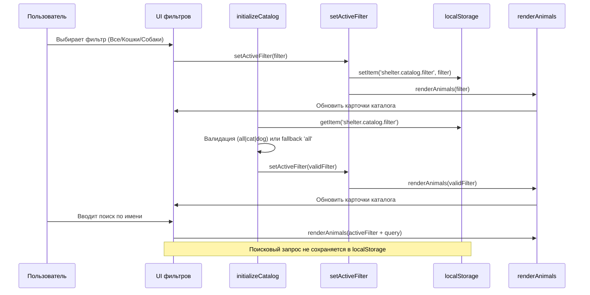

# Design

## Context

Каталог реализует фильтры вида («all», «cat», «dog») и поиск по имени (AND-логика). renderAnimals(filter) отвечает за рендер карточек и пустого состояния. setActiveFilter(filter) переключает визуальное состояние фильтров и вызывает renderAnimals. Поиск, счётчики и форма заявки уже работают.

## Goals / Non-Goals

**Goals:**
- Сохранять выбранный фильтр в localStorage и восстанавливать его при загрузке.
- Обрабатывать только поддерживаемые значения (all/cat/dog); при иных — использовать all.
- Не сохранять поисковый запрос и любые персональные данные.
- Сохранить текущее поведение поиска, счётчиков, формы и «Познакомиться».

**Non-Goals:**
- Любые сетевые запросы или backend.
- Изменение структуры данных животных.

## Decisions

- Ключ localStorage: `shelter.catalog.filter` (стабильный, описательный).
- Сохранение: при вызове setActiveFilter(filter) дополнительно записывать filter в localStorage.
- Восстановление: в initializeCatalog() читать значение, валидировать (all/cat/dog), падать обратно на all, затем вызвать setActiveFilter(validFilter). Это сохранит единый путь обновления UI.
- Валидация: сравнение по строгому списку; любые иные или нестроковые значения игнорируются.
- Без влияния на поиск: поисковое поле не записывается и инициализируется пустым, как сейчас.

Альтернативы:
- sessionStorage вместо localStorage — отклонено: требуется межсессионное запоминание.

## Взаимодействие компонентов (Mermaid)

## Risks / Trade-offs

- Повреждённое значение в localStorage: защищено валидатором, fallback на all.
- Потенциальная гонка с первым рендером: ensure порядок — восстановление фильтра до первого renderAnimals().

## Migration Plan

- Реализация без изменения DOM структуры; только логика.
- Проверить node --check и ручные сценарии: восстановление фильтра, совместимость с поиском и «Познакомиться».
