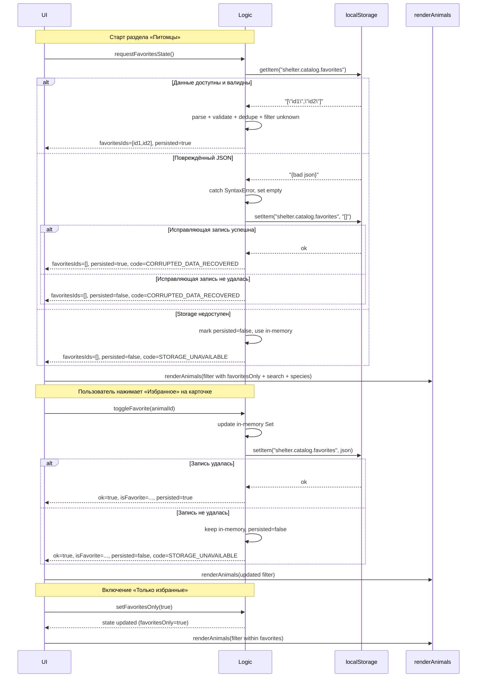

# Logic Specification: Избранные питомцы (001-favorites-pets)

Status: Draft (for human review)

Scope: логика хранения и управления множеством избранных питомцев, совместимость с существующим поиском по имени и фильтрами «Все / Кошки / Собаки». Реализация кода не входит; это договорённости и контракт.

Non-goals: изменение UI-спецификации, constitution, структура данных животных, реализация сетевых запросов.

Assumptions:
- Набор животных (каталог) доступен синхронно в памяти как массив объектов с полями id, name, species и др. (см. проектные требования).
- Единственный источник рендера карточек — функция renderAnimals(filter), которая принимает текущий фильтр (поиск/вид/«только избранные») и отрисовывает список.

---

1) Хранение множества стабильных id избранных питомцев между перезагрузками

- Тип: множество стабильных строковых идентификаторов animal.id (Set<string> в оперативной памяти; на диске — JSON-массив строк).
- Персистенция: localStorage под ключом shelter.catalog.favorites.
- Идентификаторы стабильны на протяжении жизни данных каталога; логика не создаёт и не преобразует id.
- Логика допускает пустое множество и не накладывает ограничений на размер (см. ответы на вопросы UI).
- При любом изменении множества избранных:
  - обновляется оперативное состояние (in-memory Set),
  - выполняется попытка синхронной записи в localStorage (если доступен),
  - результат операции сообщает UI статус persisted: true/false.

2) Формат данных и ключ localStorage

- Ключ: shelter.catalog.favorites
- Значение: строка JSON, парсящаяся в массив строк: string[]
  - Пример: ["cat-101", "dog-202"]
- Никаких вложенных объектов, версий и метаданных — только список id.
- Без персональных данных. Только id питомцев.

3) Чтение и валидация данных при запуске

Инициализация выполняется в трёх шагах:

3.1) Чтение
- Пытаемся прочитать item по ключу shelter.catalog.favorites.
- Если ключ отсутствует — принимаем пустой массив [].
- Любые ошибки доступа (SecurityError, QuotaExceededError в getItem) трактуются как недоступность localStorage; см. пункт 4.

3.2) Парсинг
- Выполняется JSON.parse в блоке try/catch.
- При SyntaxError/любой ошибке парсинга:
  - логика не прерывает работу каталога,
  - устанавливает пустой набор избранных в памяти,
  - пытается перезаписать localStorage корректным значением [] (исправляющая запись),
  - если исправляющая запись успешна: возвращает code=CORRUPTED_DATA_RECOVERED и persisted=true,
  - если исправляющая запись завершилась ошибкой: persisted=false, код остаётся CORRUPTED_DATA_RECOVERED, UI получает уведомление.

3.3) Валидация содержимого
- Принимается только массив (Array.isArray).
- Элементы НЕ преобразуются к строкам; принимаются только элементы типа string, не пустые (length>0) и соответствующие существующим id каталога.
- Фильтрация:
  - удаляются дубликаты (Set),
  - неизвестные id (отсутствующие в текущем каталоге животных) игнорируются,
  - элементы нестрокового типа и пустые строки игнорируются.
- Результирующий набор формирует оперативное состояние favoritesSet.
- Если после валидации набор отличается от исходного массива в хранилище (например, из-за удаления дубликатов/неизвестных id), логика при первой же удачной возможности перезапишет localStorage приведённым значением, чтобы восстановить консистентность.

4) Поведение при недоступности localStorage

- Случаи: браузер в приватном режиме, запрет/ограничения, исключения при getItem/setItem/removeItem.
- Политика: приложение продолжает работать. Избранное ведётся в оперативной памяти (in-memory Set) в рамках текущей вкладки/сессии.
- UI получает единоразовое (debounced) событие об ошибке персистенции с человекочитаемым сообщением.
- Все операции toggle/add/remove возвращают persisted=false ТОЛЬКО если соответствующая операция чтения или записи localStorage реально завершилась ошибкой. Иначе persisted=true.
- При восстановлении доступности localStorage в этой же сессии (редкий случай), ближайшая успешная операция записи синхронизирует текущий in-memory Set в localStorage.

5) Операции

API логики (синхронные, без сетевых запросов):

- getFavoritesState():
  - Возвращает объект { favoritesIds: string[], favoritesCount: number, persisted: boolean }.
  - Внутренний Set не возвращается наружу (инкапсуляция внутреннего состояния).
  - persisted указывает на текущую доступность localStorage и успешность последней синхронизации.

- isFavorite(animalId: string): boolean
  - Истина, если id присутствует в favoritesSet.

- addFavorite(animalId: string): Result
  - Предусловия: animalId существует в каталоге; иначе возвращает { ok: false, code: "UNKNOWN_ID", persisted } без изменений.
  - Идемпотентность: если id уже в наборе — { ok: true, changed: false, persisted }.
  - При добавлении: обновляет in-memory Set; пытается записать в localStorage; возвращает { ok: true, changed: true, persisted }.

- removeFavorite(animalId: string): Result
  - Если id отсутствует — { ok: true, changed: false, persisted } (идемпотентно).
  - При удалении: обновляет Set; синхронизирует хранилище; { ok: true, changed: true, persisted }.

- toggleFavorite(animalId: string): Result & NewState
  - Упрощённая операция для UI: вызывает add/remove в зависимости от текущего состояния.
  - Возвращает новое значение isFavorite для этого id, общий счёт favoritesCount, persisted.

Контракт результата (Result):
- ok: boolean
- changed?: boolean (была ли фактическая смена набора)
- isFavorite?: boolean (текущее состояние для id)
- persisted: boolean (удалось ли сохранить в localStorage)
- code?: "UNKNOWN_ID" | "STORAGE_UNAVAILABLE" | "CORRUPTED_DATA_RECOVERED" | "OK_NOOP"
- message?: string (локализуемое человекочитаемое пояснение для UI)
Примечание: поле persisted присутствует во всех Result без исключения, включая UNKNOWN_ID.

6) Совместная работа с поиском (по имени) и фильтрами Все/Кошки/Собаки

- Логика предоставляет флаг favoritesOnly (boolean) и множество favoritesSet.
- Рендер выполняется через существующую функцию renderAnimals(filter), где filter определяется UI на основе:
  - searchTerm (имя),
  - speciesFilter (all/cat/dog),
  - favoritesOnly (true/false) + favoritesSet.
- Комбинированная фильтрация:
  - Если favoritesOnly=false: поиск и фильтр вида применяются ко всем животным.
  - Если favoritesOnly=true: базовый набор ограничен favoritesSet; затем внутри него применяются поиск (по name, case-insensitive) и species.
- Снятие избранного в режиме favoritesOnly немедленно исключает карточку из списка (после пересчёта filter), включая случай удаления последнего избранного — UI отображает пустое состояние.

7) Сценарии

Основной (happy path):
1. Пользователь отмечает питомца избранным: toggleFavorite → ok=true, isFavorite=true, persisted=true; UI обновляет кнопку (aria-pressed=true) и сообщает в aria-live.
2. Включает «Только избранные»: favoritesOnly=true; renderAnimals применяет подмножество; поиск и фильтры работают внутри подмножества.
3. Перезагрузка страницы: начальная инициализация считывает список, валидация проходит, состояние восстановлено.

Ошибочные:
- Повреждённый JSON в localStorage: при запуске JSON.parse бросает; устанавливается пустой набор; выполняется исправляющая запись []; при успешной записи code="CORRUPTED_DATA_RECOVERED", persisted=true; при ошибке записи — тот же code и persisted=false.
- Недоступный localStorage: при попытке записи/чтения ловим исключение; операции остаются в памяти; UI получает ненавязчивое сообщение (однотипное) и продолжает работу.
- Неизвестный id: toggleFavorite("ghost") → ok=false, code="UNKNOWN_ID"; UI показывает мягкую ошибку, состояние не меняется.

Граничные:
- Дубликаты в хранилище: при инициализации удаляются; перезапись приведённого массива в localStorage при первой возможности.
- Пустое множество при включённом favoritesOnly: UI показывает пустое состояние без мерцаний; CTA «Вернуться к списку» выключает favoritesOnly.
- Большое количество избранных: ограничений нет; операции остаются O(1) на toggle (за счёт Set).

Регрессионные:
- Поиск по имени и фильтры видов продолжают работать без изменений, когда favoritesOnly=false.
- Форма заявки «Познакомиться» и существующие функции не зависят от состояния избранного.

8) Ожидаемый контракт с командой UI

Входы (от логики к UI):
- Начальное состояние: { favoritesIds: string[], favoritesOnlyDefault: false, persisted: boolean }.
- Событие состояния: onFavoritesChanged(payload) с полями:
  - changedIds?: string[] (изменившиеся id)
  - favoritesIds: string[]
  - favoritesCount: number
  - persisted: boolean
  - message?: string (например, при STORAGE_UNAVAILABLE)

Сигналы (от UI к логике):
- toggleFavorite(animalId: string)
- setFavoritesOnly(enabled: boolean)
- requestFavoritesState() — для явной синхронизации при загрузке раздела

Результаты операций:
- Успех: обновлённое состояние выбранного id, актуальный массив favoritesIds, persisted=true|false.
- Ошибка: ok=false с code и message; favoritesIds не меняется.

9) Ответы на вопросы UI

- Долговременность: избранное сохраняется между сессиями (через localStorage), при условии доступности хранилища и корректных данных.
- Ограничения: ограничений количества избранных нет на уровне логики.
- Ошибки хранения: при ошибке localStorage используется состояние в памяти; UI получает понятное ненавязчивое сообщение и persisted=false в ответах, что позволяет показать подсказку «Состояние не сохранится после перезагрузки».

10) Mermaid sequenceDiagram

11) Измеримые критерии приёмки

- AC-LOGIC-001: Инициализация с валидным JSON восстанавливает 100% отмеченных id; отрисовка происходит без ошибок консоли.
- AC-LOGIC-002: Повреждённый JSON не вызывает падения: выполняется исправляющая запись []. Если запись успешна — UI получает code=CORRUPTED_DATA_RECOVERED и persisted=true; если запись неудачна — persisted=false, но каталог продолжает работу с пустым набором.
- AC-LOGIC-003: Недоступный localStorage: persisted=false возвращается только для тех операций чтения/записи, которые реально завершились ошибкой; состояние сохраняется в памяти до перезагрузки; UI показывает ненавязчивое сообщение один раз за сессию.
- AC-LOGIC-004: Дубликаты в хранилище устраняются при первом чтении; при первой успешной записи localStorage содержит уникальный, отсортированный (опционально) массив.
- AC-LOGIC-005: Комбинация favoritesOnly + поиск по имени + фильтры вида даёт корректный результат в 100% протестированных комбинаций (см. чек-лист).
- AC-LOGIC-006: Идемпотентность: повторные addFavorite на уже избранном и removeFavorite на не избранном не меняют состояние и возвращают changed=false.
- AC-LOGIC-007: Производительность: toggleFavorite → событие onFavoritesChanged и вызов renderAnimals занимают ≤ 50 мс на среднестатистическом устройстве при N≤100 карточек.
