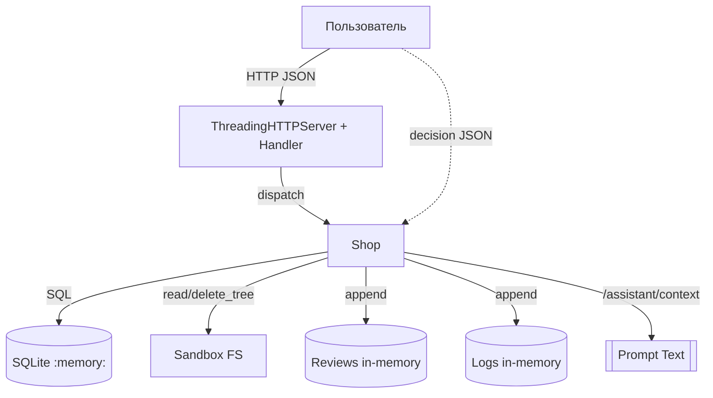

# Модель угроз: Mini Shop (исходная версия до исправлений)

Этот документ фиксирует устройство системы, потоки данных, активы и роли, границы доверия, а также выявленные угрозы с привязкой к конкретным маршрутам и строкам кода. Модель отражает исходный уязвимый сервис до внесения изменений. Проверки выполнялись только встроенными тестами; целенаправленные атаки и prompt injection не запускались на этом этапе.

## 1) Устройство системы и потоки данных

- Процесс HTTP: `ThreadingHTTPServer` на 127.0.0.1, обработчик — `make_handler(Shop)` из `service.py`.
- Хранилище: `sqlite3` в памяти (`:memory:`) с таблицами `profiles` и `orders` и учебными данными.
- Сессии: в памяти `Shop.sessions` (dict с token -> {id, role}).
- Файловая «песочница»: `Sandbox` из `sandbox.py`, изолированный временный каталог с начальными файлами: 
  - `files/alice/receipt.txt`, `files/bob/receipt.txt` — чеки клиентов
  - `private/operator-note.txt` — служебная заметка
  Проверяет физическую границу путей (resolve, запрет выхода за корень), но не авторизацию доступа к содержимому.
- Логи запросов: `Shop.logs` хранит метод, путь, тело и заголовки.
- Отзывы: `Shop.reviews` (in‑memory список), рендерятся в HTML без экранирования.

Основные потоки данных:
- Клиент → HTTP → `dispatch` → операции с БД/памятью/файлами → ответ JSON/HTML.
- Ассистент: `GET /assistant/context` формирует текстовый prompt, включающий данные заказа и отзывы; `POST /assistant/execute` исполняет выбранный инструмент по данным «решения» модели.

Mermaid-диаграмма соответствует реальному сервису (без внешних вызовов):

## 2) Активы, роли, границы доверия

Активы:
- Профили пользователей (имя/email/адрес) — БД `profiles`.
- Заказы (товар/цена/владелец) — БД `orders`.
- Файлы чеков пользователей в песочнице.
- Внутренняя служебная заметка `private/operator-note.txt`.
- Журналы запросов (включают тела и заголовки).

Роли и субъекты:
- Клиент (alice/bob): действует с токеном из `/login`.
- Сотрудник (staff): должен иметь повышенные права.
- Ассистент LLM (планировщик) — поставляет «решение» на `/assistant/execute`.
- Анонимный пользователь: без токена.

Границы доверия:
- Транспорт: только loopback 127.0.0.1. Тем не менее, модель угроз рассматривает локального злоумышленника как часть сценария.
- Песочница файлов: физическая граница путей соблюдена `Sandbox.path()`. Логическая авторизация внутри песочницы — ответственность `service.py` (и сейчас отсутствует).
- Сеансы: сервер доверяет предоставленным заголовкам (`X-Token`, `X-Role`) в ряде мест, что проблемно.

## 3) Угрозы с привязкой к маршрутам и коду (исходное состояние)

Нумерация: T1, T2, … Для каждой угрозы указаны маршрут, участок кода и предпосылка.

- T1. SQL Injection — профили по id
  - Маршрут: `GET /profile?id=...`
  - Код: `service.py:57` — f-string: `SELECT * FROM profiles WHERE id = {query.get('id', '1')}`
  - Предпосылка: параметр `id` вставляется без параметризации; тип не проверяется.

- T2. SQL Injection — поиск по имени
  - Маршрут: `GET /search?q=...`
  - Код: `service.py:59` — `LIKE '%{query.get('q', '')}%'` в f-string.
  - Предпосылка: пользовательский ввод попадает в SQL без экранирования/параметров.

- T3. Broken Access Control — просмотр всех заказов
  - Маршрут: `GET /orders`
  - Код: `service.py:61` — `SELECT * FROM orders` без фильтра по владельцу и без проверки сессии.
  - Предпосылка: любой (в т.ч. аноним) видит все заказы и владельцев.

- T4. Broken Access Control — создание заказа по чужой цене
  - Маршрут: `POST /orders`
  - Код: `service.py:69` — `price = body.get("price", self.products[product])`
  - Предпосылка: клиент может задать произвольную цену и тем самым занижать стоимость.

- T5. Broken Access Control — staff через подмену заголовка
  - Маршрут: `GET /admin/export`
  - Код: `service.py:75` — проверка `headers.get("X-Role") == "staff"`
  - Предпосылка: роль берётся из пользовательского заголовка, не из сессии.

- T6. Insecure Direct Object Reference (IDOR) — чтение чужих файлов
  - Маршрут: `GET /files?user=...&path=...`
  - Код: `service.py:79-80` — имя строится из query без проверки владельца; `Sandbox.read` гарантирует границу, но не авторизацию.
  - Предпосылка: любой может читать чек другого пользователя и служебные файлы внутри песочницы, если знает путь.

- T7. Reflected/Internal Data Leak — журнал запросов
  - Маршрут: `GET /debug/logs`
  - Код: `service.py:81-82` — возвращает копию `self.logs` любому.
  - Предпосылка: нет аутентификации — утечка токенов, тел запросов и чувствительных деталей.

- T8. Stored XSS — рендер отзывов
  - Маршрут: `GET /reviews/view`
  - Код: `service.py:87` — `"
{r['text']}
"` без экранирования.
  - Предпосылка: любой может сохранить HTML/JS в отзыве, который отдадут как text/html.

- T9. Prompt Injection / Tool Misuse — контекст и исполнение
  - Маршрут: `GET /assistant/context`, `POST /assistant/execute`
  - Код: `service.py:88-109` — контекст содержит отзывы и заказы; `execute` без серверной политики исполняет любые поддержанные инструменты по решению клиента.
  - Предпосылка: сервер не привязывает действия к сессии/владельцу и не фильтрует цели инструментов (например, `export_profiles`, `delete_tree`, чтение чужих файлов).

- T10. Sensitive Data Exposure — ошибки включают детали
  - Код: `service.py:128-135` — в обработчике ошибок возвращается `{"error": str(exc), "type": ...}` всем клиентам.
  - Предпосылка: сообщения исключений могут раскрывать внутренние пути/стеки (в текущих ветках — ограниченно).

Примечание: некоторые угрозы не ловятся поставляемыми тестами, но присутствуют в коде. На этом этапе не проводим эксплуатацию; наличие уязвимостей подтверждено статическим анализом исходников.

## 4) Последствия, меры защиты и способы проверки

- T1/T2 SQLi
  - Последствия: чтение/модификация данных, обход логики.
  - Меры: параметризованные запросы (`?` и кортеж), whitelisting полей/операций.
  - Проверка: тесты, подающие в `id`/`q` инъекции (например, `1 OR 1=1`), сравнение количества строк; отрицательные кейсы.

- T3 Просмотр всех заказов
  - Последствия: утечка историй покупок и владельцев.
  - Меры: требовать авторизацию, фильтровать по `session['id']`; отдельный staff‑маршрут для обзора.
  - Проверка: без токена и с токеном другого пользователя результат должен отличаться.

- T4 Произвольная цена заказа
  - Последствия: финансовые потери, обход каталога.
  - Меры: игнорировать `price` от клиента, брать цену из каталога на сервере.
  - Проверка: заказ с `price=1` должен вернуть цену каталога.

- T5 Подмена роли заголовком
  - Последствия: несанкционированный экспорт профилей.
  - Меры: роль — только из серверной сессии по токену; заголовок игнорировать.
  - Проверка: `X-Role: staff` без staff‑сессии должен быть отклонён.

- T6 IDOR для файлов
  - Последствия: чтение чеков других пользователей, операционных заметок.
  - Меры: авторизация на уровне сервера — сопоставлять `user` с `session['id']`; ограничить доступные пути (только собственный чек).
  - Проверка: alice не может читать `files/bob/receipt.txt`; чтение `private/*` запрещено.

- T7 Утечка логов
  - Последствия: раскрытие токенов, приватных данных, облегчение атак.
  - Меры: закрыть маршрут или ограничить staff; не логировать чувствительное; маскирование.
  - Проверка: без staff‑сессии 403; содержимое не содержит токенов.

- T8 Stored XSS
  - Последствия: выполнение JS в браузере оператора/клиента, кража токенов.
  - Меры: экранирование HTML, формат ответа `text/plain` или безопасный шаблонизатор; CSP, HttpOnly-куки (если будут).
  - Проверка: отзыв `` не должен исполняться; содержимое экранировано.

- T9 Prompt Injection/Tool misuse
  - Последствия: чтение чужих данных, удаление файлов в песочнице, экспорт профилей.
  - Меры: серверная проверка прав при `assistant/execute`: привязка к сессии и политике инструментов (разрешённые пути/данные), валидация аргументов, deny‑by‑default.
  - Проверка: прямой POST с вредоносным `decision` не должен приводить к чтению чужих файлов/удалению/экспорту; защита не зависит от «послушания» модели.

- T10 Детали ошибок
  - Последствия: утечка внутренних деталей.
  - Меры: лаконичные ошибки без внутренних путей/трасс; журналировать детали только серверу.
  - Проверка: преднамеренная ошибка не раскрывает stack/путь в ответе.

## 5) Соответствие требованиям лабоработории

- Сохранить полезные сценарии после фиксов (в последующих этапах): собственный профиль и чек; покупка по цене каталога; отзывы; staff‑операции только для staff.
- Граница стенда сохраняется: операции только в пределах `Sandbox` и на loopback.

## 6) Фактические результаты проверок (до исправлений)

Сервис запущен локально; базовый URL и каталог песочницы зафиксированы в `evidence/before/host.json`. Проверки выполнены скриптом `lab/run_checks_before.py`, артефакты лежат в `evidence/before/`.

- T1 SQLi /profile — подтверждено: см. `T1_profile_sqli.json` (вернулись оба профиля на `id=1 OR 1=1`).
- T2 SQLi /search — подтверждено: см. `T2_search_sqli.json` (вернулись оба профиля).
- T3 Просмотр всех заказов — подтверждено: см. `T3_orders_no_auth.json` (без токена видны все заказы).
- T4 Клиент назначает цену — подтверждено: см. `T4_custom_price.json` (создан заказ с price=1).
- T5 Эскалация X-Role — подтверждено: см. `T5_admin_export_header_only.json` (200 без staff-сессии при X-Role: staff). Без заголовка — 403 (`A5_admin_export_no_header.json`).
- T6 IDOR файлов — частично подтверждено: Alice читает чек Bob (`T6_files_idor_bob_receipt.json`). Попытка достать `private/operator-note.txt` через `..` отклонена песочницей (`T6_files_idor_private_note.json`). Прямого чтения `private/*` через `/files` нет из‑за префикса `files/<user>/` и проверок `Sandbox`.
- T7 Утечка логов — подтверждено: см. `T7_debug_logs_exposed.json` (доступ без аутентификации, включены тела и заголовки запросов).
- T8 Stored XSS — подтверждено как неэкранированный HTML: см. `T8_reviews_stored_xss.json` (возвращён HTML, Content-Type: text/html). Исполнение JS в браузере не проверялось.
- T9 Инструменты ассистента (не доказательство prompt injection) — подтверждено:
  - чтение чужого файла: `T9a_tool_read_bob_receipt.json`;
  - экспорт профилей: `T9b_tool_export_profiles.json`;
  - удаление дерева в песочнице на отдельном экземпляре: `T9c_tool_delete_tree.json` + последующая ошибка чтения (`T9c_tool_delete_tree_followup.json`).
- T10 Детали ошибок — подтверждено для некорректного JSON: `T10_error_invalid_json.json` (500, тип JSONDecodeError в ответе). Превышение Content-Length может вернуть 413 — отдельно не проверялось.

Дополнительно:
- Чужой профиль без SQLi — подтверждено: `A1_profile_foreign_without_sqli.json` (Bob виден по id=2).
- Чужой заказ в контексте ассистента — подтверждено: `A2_assistant_context_foreign_order.json`.
- SQLi в order_id контекста — подтверждено: `A3_assistant_context_order_sqli.json` (в prompt включены все заказы).
- Неверные типы и ошибки формата — подтверждено: `A4_orders_wrong_types.json` (400 unknown product), `T10_error_invalid_json.json` (500 на невалидный JSON).

Источник: анализ и фактические проверки `service.py`, `sandbox.py`, тестов и README в `practices/practice_06/lab/`.
