# Отчёт по домашней работе 7.1

<<<<<<< HEAD
Тестовый Pull Request: [Neiskkk/ITMOv2#9](https://github.com/Neiskkk/ITMOv2/pull/9)

## 1. Вторая модель по команде `/make_other_ai_review`

**Статус: критерий выполнен — 2/2 балла.**

=======
**Ссылка на тестовый Pull Request:** [https://github.com/Neiskkk/ITMOv2/pull/9](https://github.com/Neiskkk/ITMOv2/pull/9)

## 1. Вторая модель по команде `/make_other_ai_review`

>>>>>>> 3ea3a2c (Complete practice 7.1 report and execution screenshots)
### Реализация

В workflow добавлены:

- `PR Comment Trigger` — получает новые комментарии GitHub
- `If make_other_ai_review` — проверяет `action == created` и точное совпадение текста с `/make_other_ai_review`
- `Normalize PR context` — приводит данные об открытии PR и комментарии к общим полям `repo_full_name`, `pr_number` и `command`
- `If use other model` — направляет `/make_other_ai_review` в отдельную AI-ветку
- `Code Review Agent Other` — формирует альтернативное ревью
- `GitHub Robot1` — публикует результат в PR

Основная модель — `openai/gpt-5.2`.

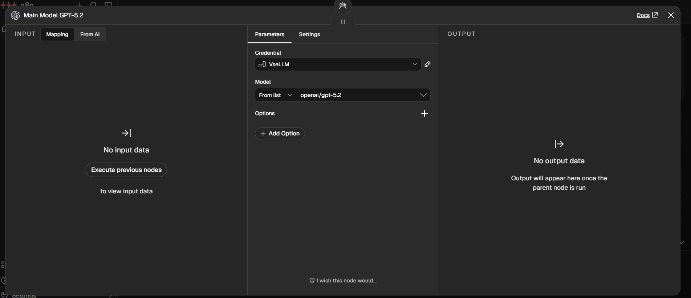

Вторая модель — `anthropic/claude-sonnet-4.6`.

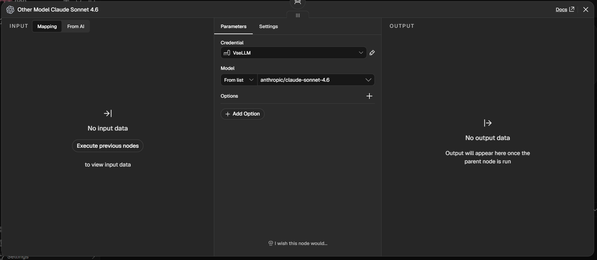

### Подтверждение запуска

Команда `/make_other_ai_review` была опубликована в PR №9. Execution `ID#264` завершился со статусом `Succeeded` за 13.643 с. На схеме видно, что `If use other model` направил запрос в `Code Review Agent Other`, после чего выполнились `GitHub Robot1` и `Add Label to PR1`.

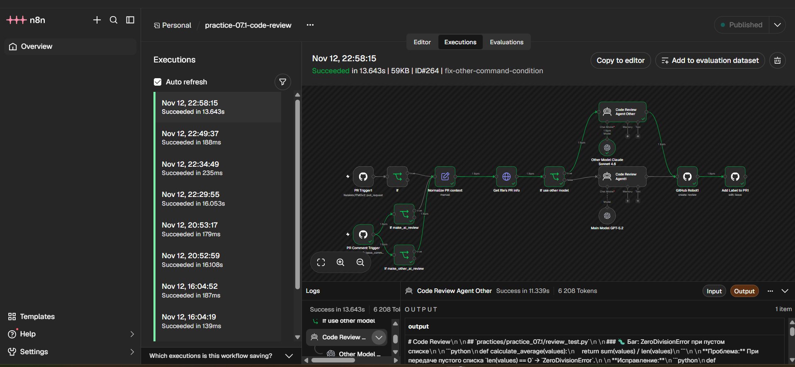

### Сравнение результатов

Основная модель GPT-5.2:

- нашла `ZeroDivisionError` для пустого списка
- обратила внимание на работу с итераторами и генераторами
- предложила варианты с явным исключением и однопроходным подсчётом

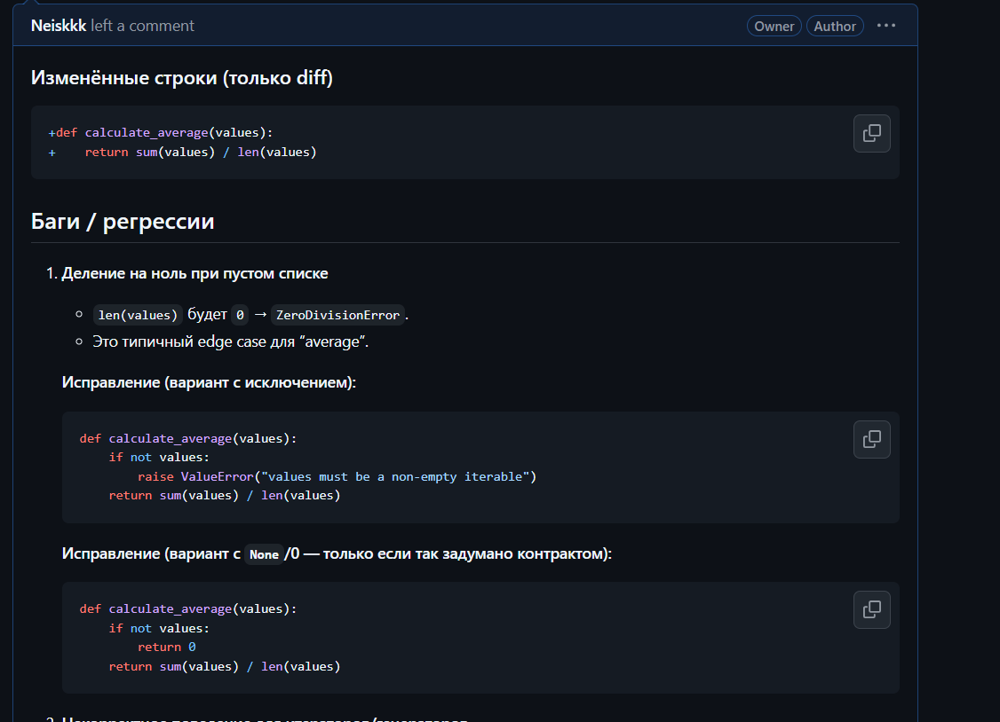

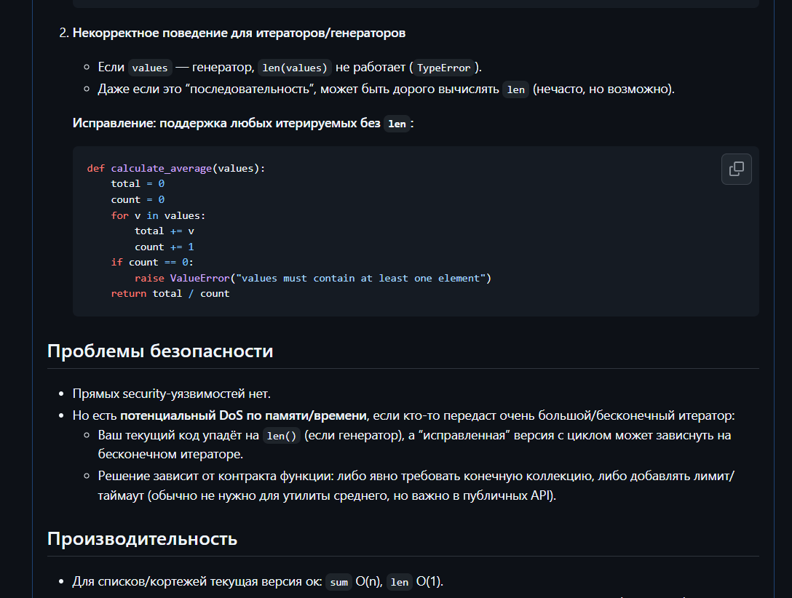

Вторая модель Claude Sonnet 4.6:

- также нашла `ZeroDivisionError`
- дополнительно предложила валидацию нечисловых значений
- дала другую структуру и формулировки замечаний
- проанализировала также JSON workflow, поэтому её ответ получился более широким

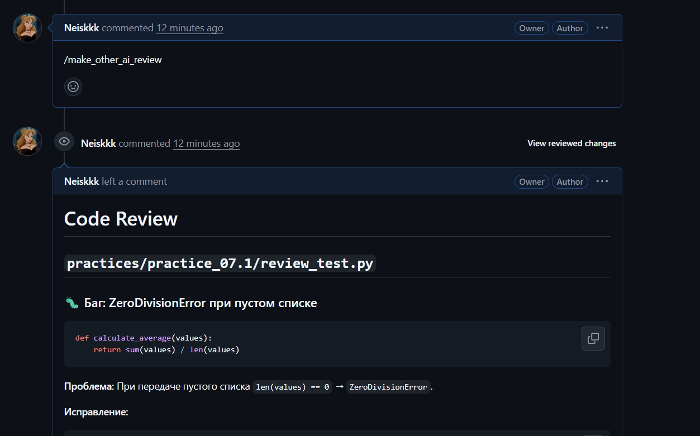

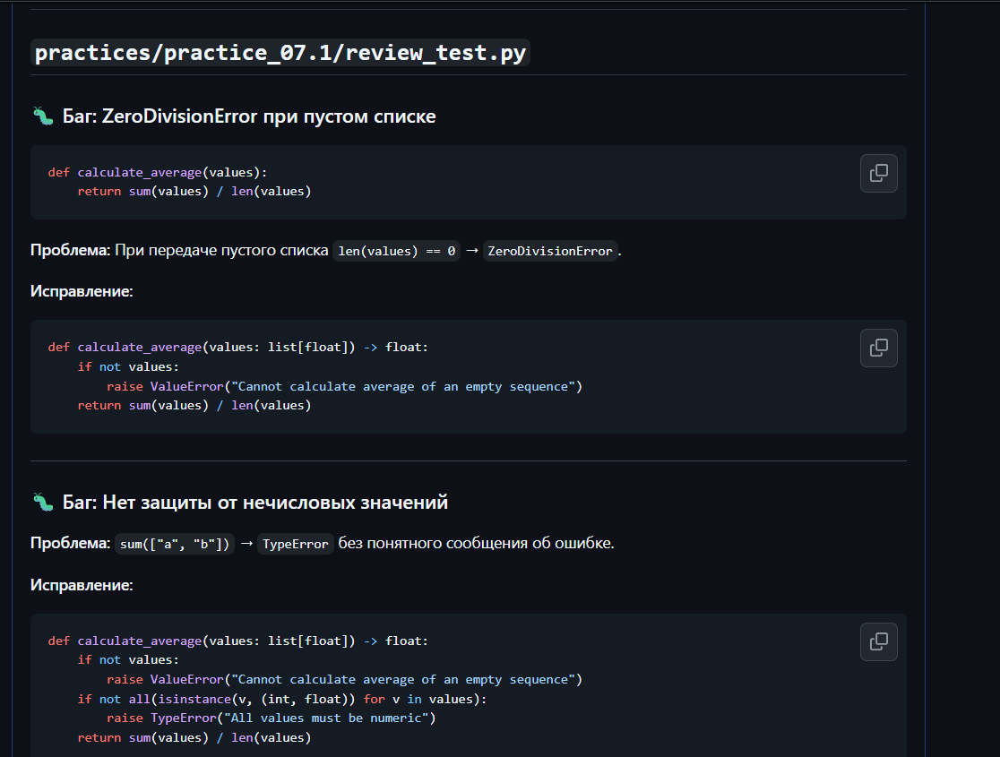

## 2. Data Table для хранения проверенных PR

В n8n создана Data Table `reviewed_pull_requests`. Таблица хранит состояние workflow: после успешного AI-ревью в неё записываются репозиторий, номер PR, команда, модель и время запуска.

| Поле | Тип | Назначение |
|---|---|---|
| `review_key` | String | Составной ключ `repository#pr_number#command` |
| `pr_id` | String | Уникальный идентификатор `repository#pr_number` |
| `repository` | String | Полное имя репозитория |
| `pr_number` | Number | Номер PR |
| `command` | String | Команда, запустившая ревью |
| `model` | String | Выбранная AI-модель |
| `reviewed_at` | String | Время успешного ревью |

После `Add Label to PR1` добавлена нода `Save reviewed PR` с операцией `Insert`. Значения колонок формируются из данных `Normalize PR context`. Поле `model` зависит от команды, а `reviewed_at` заполняется текущим временем n8n.

Команда `/make_ai_review` была повторно отправлена в PR №9. Execution `ID#278` завершился со статусом `Succeeded` за 27.103 с. Нода `Save reviewed PR` успешно добавила строку в Data Table.

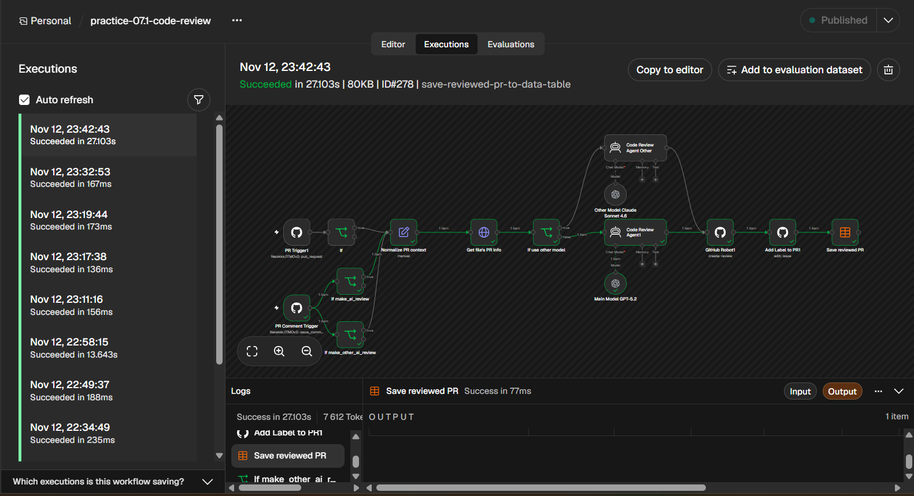

В таблице сохранена строка для `Neiskkk/ITMOv2#9` и команды `/make_ai_review`.

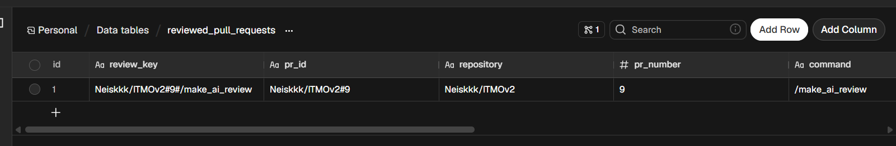

## 3. Исключение повторного запуска ревью

Перед `Normalize PR context` добавлена нода `Continue if review missing`. Она проверяет наличие `review_key` в таблице `reviewed_pull_requests` и пропускает выполнение дальше только для PR, которого ещё нет в таблице.

В PR №9 повторно отправлена команда `/make_ai_review`. Execution `ID#3738` завершился со статусом `Succeeded` за 253 мс. Нода `Continue if review missing` обнаружила существующую запись, поэтому `Normalize PR context`, AI Agent и ноды публикации комментария не запускались.

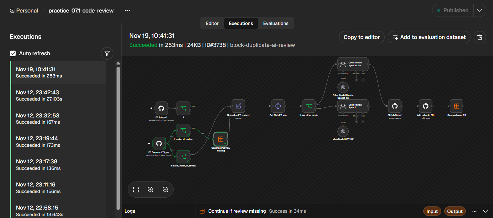

После повторной команды в Data Table осталась одна строка для `Neiskkk/ITMOv2#9#/make_ai_review`, то есть дубликат не был добавлен.

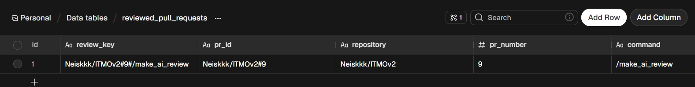

## 4. Точечные комментарии к изменённому коду

После получения diff нода `Split diff into blocks` разбивает его на отдельные блоки и определяет для каждого файла поля `path`, `line` и `side`. Каждый блок отдельно передаётся выбранному AI Agent. Нода `Build inline review` собирает ответы в массив `comments`, а `Publish inline review` отправляет его в GitHub API.

Execution `ID#4055` завершился со статусом `Succeeded` за 34.422 с. В ходе запуска было выделено и обработано три блока изменений, после чего точечные комментарии были опубликованы в PR.

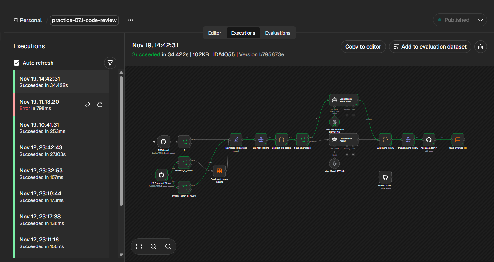

Во вкладке `Files changed` комментарий отображается непосредственно у изменённой строки файла, а не как общий комментарий под PR.

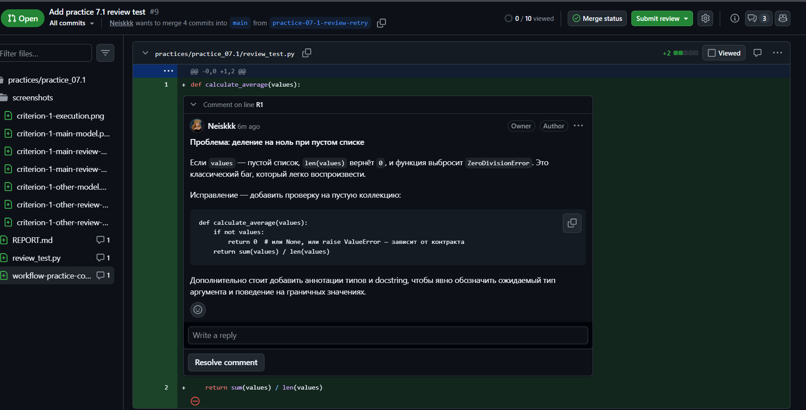
