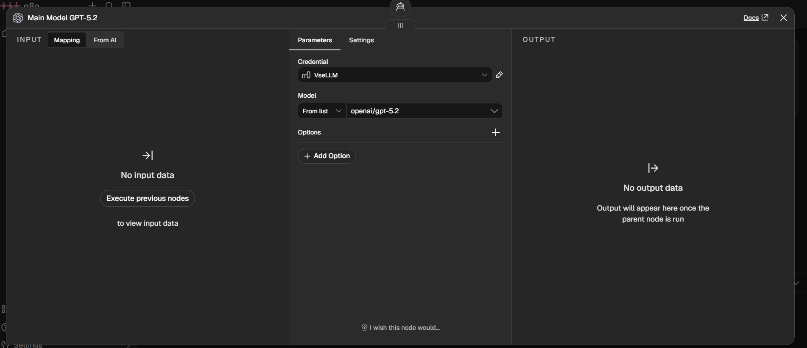
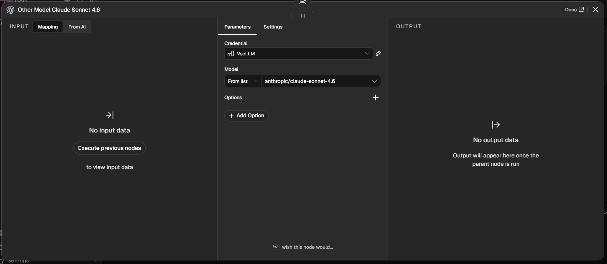
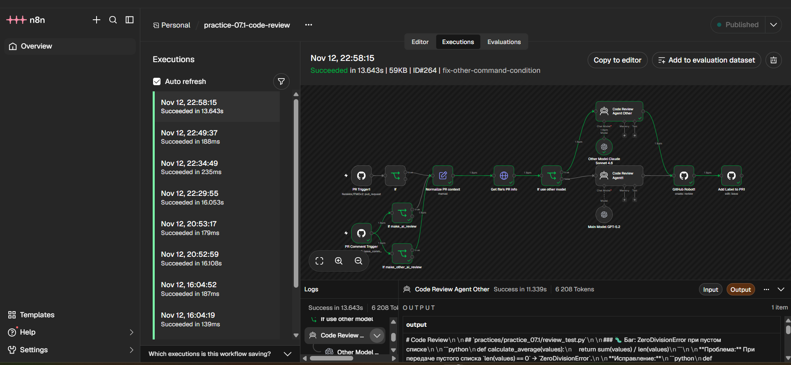
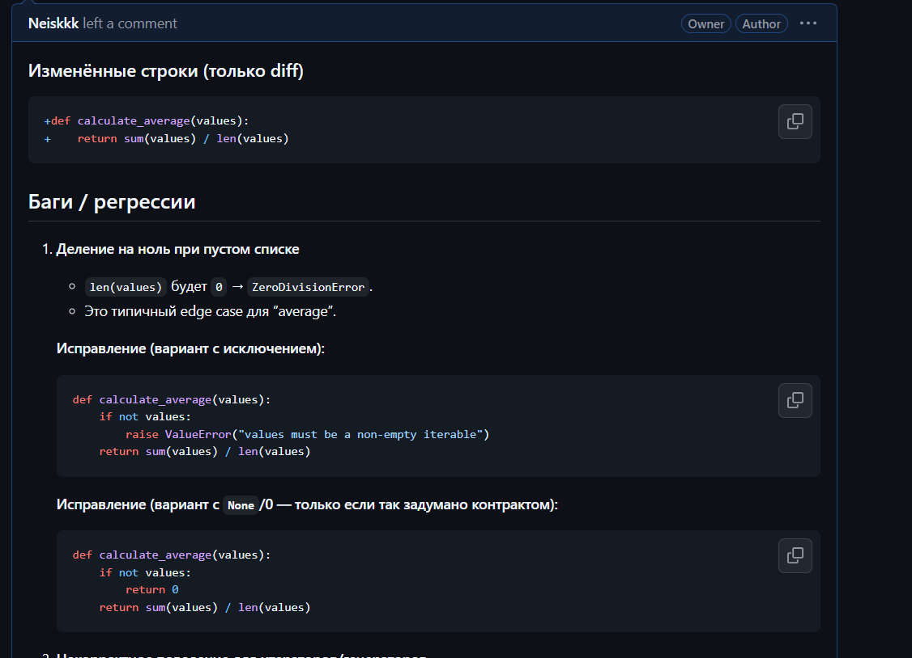
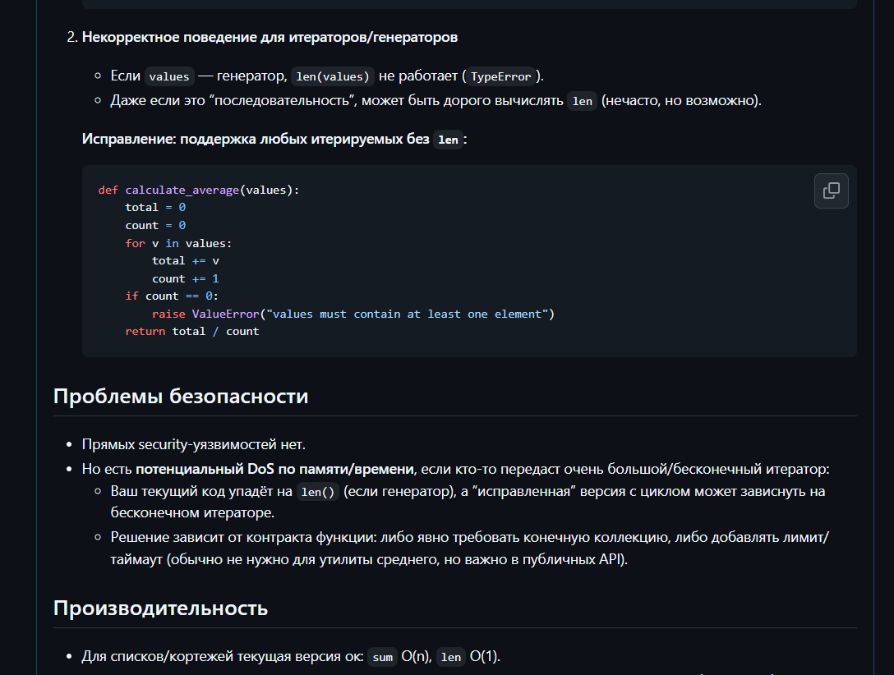
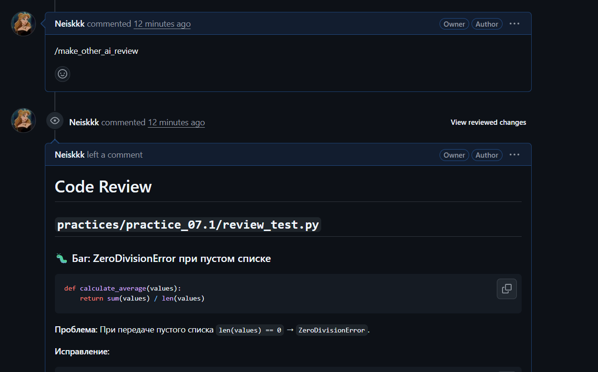
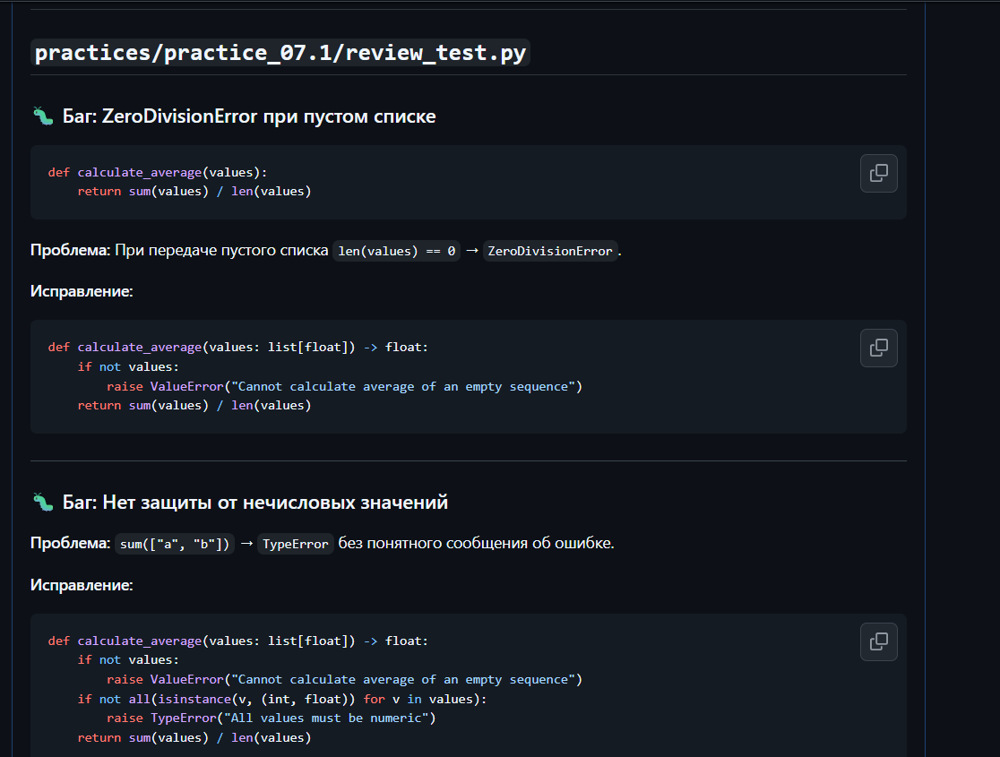

# Отчёт по домашней работе 7.1

Тестовый Pull Request: [Neiskkk/ITMOv2#9](https://github.com/Neiskkk/ITMOv2/pull/9)

## 1. Вторая модель по команде `/make_other_ai_review`

**Статус: критерий выполнен — 2/2 балла.**

### Реализация

В workflow добавлены:

- `PR Comment Trigger` — получает новые комментарии GitHub;
- `If make_other_ai_review` — проверяет `action == created` и точное совпадение текста с `/make_other_ai_review`;
- `Normalize PR context` — приводит данные об открытии PR и комментарии к общим полям `repo_full_name`, `pr_number` и `command`;
- `If use other model` — направляет `/make_other_ai_review` в отдельную AI-ветку;
- `Code Review Agent Other` — формирует альтернативное ревью;
- `GitHub Robot1` — публикует результат в PR.

Основная модель — `openai/gpt-5.2`.

Вторая модель — `anthropic/claude-sonnet-4.6`.

### Подтверждение запуска

Команда `/make_other_ai_review` была опубликована в PR №9. Execution `ID#264` завершился со статусом `Succeeded` за 13.643 с. На схеме видно, что `If use other model` направил запрос в `Code Review Agent Other`, после чего выполнились `GitHub Robot1` и `Add Label to PR1`.

### Сравнение результатов

Основная модель GPT-5.2:

- нашла `ZeroDivisionError` для пустого списка;
- обратила внимание на работу с итераторами и генераторами;
- предложила варианты с явным исключением и однопроходным подсчётом.

Вторая модель Claude Sonnet 4.6:

- также нашла `ZeroDivisionError`;
- дополнительно предложила валидацию нечисловых значений;
- дала другую структуру и формулировки замечаний;
- проанализировала также JSON workflow, поэтому её ответ получился более широким;
- часть выводов требует ручной проверки, что показывает необходимость code review самих AI-ответов.

## 2. Data Table для хранения проверенных PR

**Статус: в работе.**

Планируемая таблица `reviewed_pull_requests`:

| Поле | Тип | Назначение |
|---|---|---|
| `review_key` | String | Составной ключ репозитория, PR и команды |
| `pr_id` | String | ID проверенного PR |
| `repository` | String | Полное имя репозитория |
| `pr_number` | Number | Номер PR |
| `command` | String | Команда, запустившая ревью |
| `model` | String | Выбранная AI-модель |
| `reviewed_at` | String | Время успешного ревью |
