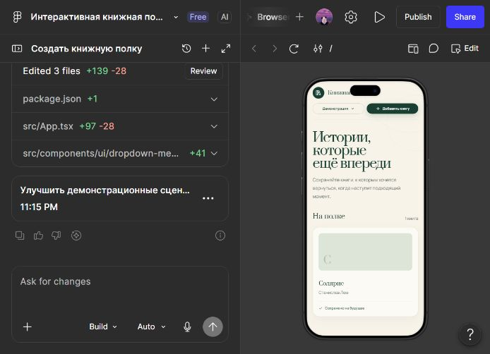

# Практика 8. Книжная полка

**Максимум по README — 12 баллов.** Проект находится в `practices/practice_08/bookshelf`. Из этой папки команда `npm run dev` запускает приложение, а `npm test` — все клиентские тесты. В Ubuntu (WSL) прошли 6 из 6 тестов за 7,6 секунды. [Инструкция по запуску](README.md) · [Вывод тестов в WSL](report/tests-wsl.txt)

## 1. Макет или прототип с помощью AI — 3 балла

## 2. Использование готовых компонентов — 0,5 балла

Папка `src/components/ui`, файл `src/App.tsx` и диалог «Новая книга» в приложении. [Запрос с перечнем компонентов](../FIGMA.md)

В коде импорт Button на строке 16 и его использование для «Сохранить книгу» на строке 414

## 3. Единые цвета, типографика и отступы — 0,5 балла

Блок `@theme` в `src/index.css`, строка 5, и варианты кнопки в `src/components/ui/button.tsx`.

## 4. Полный сценарий с реальным API — 1 балл
В Network установить фильтр `api/books`. Добавить книгу с новым названием. Открыть запрос POST, показать введённые данные, статус 201 и карточку в интерфейсе. Перезагрузить страницу: запрос GET вернёт список с сохранённой книгой.

## 5. Соответствие интерфейса макету — 1 балл

Две вкладки рядом
## 6. Подписи полей, управление с клавиатуры и видимый фокус — 1 балл

Клавишей Tab перейти к «Добавить книгу», показать обводку и нажать Enter. Ввести название, по Tab перейти к полю «Автор», ввести автора и нажать Enter. Показать карточку. Снова открыть диалог и закрыть по Esc: фокус вернётся к кнопке открытия. При ширине 390 px проверить читаемость подписей и доступность кнопок.

## 7. Защита от повторной отправки — 1 балл

Тест на строке 45 файла `tests/books.spec.ts` и обработчик отправки в `src/App.tsx`, строка 121. [Код тестов](tests/books.spec.ts)

Запустить `npm test -- -g "двойной клик"`. В тесте показать, как задерживается ответ на POST, выполняются двойной клик и повторный Enter. Пока запрос выполняется, кнопка заблокирована. После ответа тест проверяет одну карточку и точное число запросов: `expect(posts).toBe(1)`.

## 8. Созданные с AI тесты компонентов и взаимодействий — 1 балл

Файл `tests/books.spec.ts`. Проверка клавиатуры и диалога начинается на строке 18; заполнение полей и нажатие кнопки повторной попытки проверяются в тесте со строки 72.

Запустить `npm test -- -g "Клавиатура, диалог"`. Tab выбирает кнопку, Enter открывает диалог, фокус попадает в поле «Название», Esc закрывает диалог и возвращает фокус. В проверке со строки 72 показать ввод текста и поиск карточки после нажатия «Попробовать снова».

## 9. Валидация обязательных полей и некорректного ввода — 1 балл

Обычная форма «Добавить книгу» в локальном приложении и тест на строке 34 файла `tests/books.spec.ts`.

Ввести три пробела в «Название», оставить «Автор» пустым и нажать «Сохранить книгу». Показать оба сообщения у полей. В тесте показать проверку `expect(posts).toBe(0)`: форма отклонила данные ещё до отправки.

## 10. Тесты загрузки, пустых данных, успеха и ошибки — 1 балл

Перехват `/api/books` через `page.route` в файле `tests/books.spec.ts`, строки 45, 72 и 88.

На строке 88 проследить загрузку списка: пока ответ задержан, видно «Загружаем полку…»; после сбоя доступна повторная загрузка; ответ `[]` открывает пустую полку. На строке 72 показать сохранение: первый POST возвращает 500, значения остаются в полях; повторный POST возвращает 201, появляется карточка. Для проверки самого теста вывод ошибки временно отключили: проверка видимости сообщения упала. После восстановления кода полный прогон прошёл. [Вывод при временной поломке](report/mutation.txt) · [Успешный прогон](report/tests-wsl.txt)

## 11. Автоматическая проверка основного сценария целиком — 1 балл

Последний тест в `tests/books.spec.ts`, строка 104. Для него запускается настоящий API с отдельным временным хранилищем.

Запустить `npm test -- -g "Настоящий API"`. Проследить путь от открытия формы и ввода Solaris и Stanislaw Lem до появления карточки. После перезагрузки тест снова находит название и автора. В завершение запустить `npm test` и показать итог по всем шести тестам. [Сохранённый результат в WSL](report/tests-wsl.txt)

