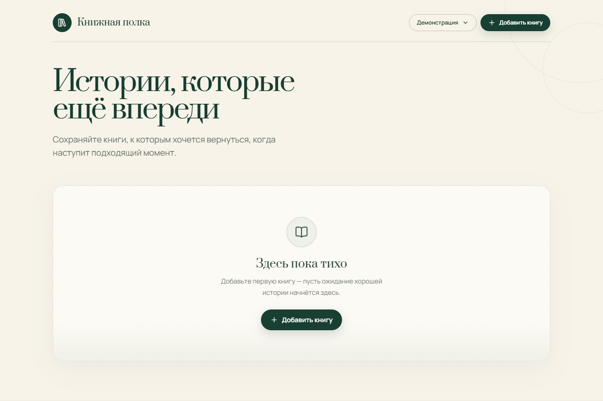
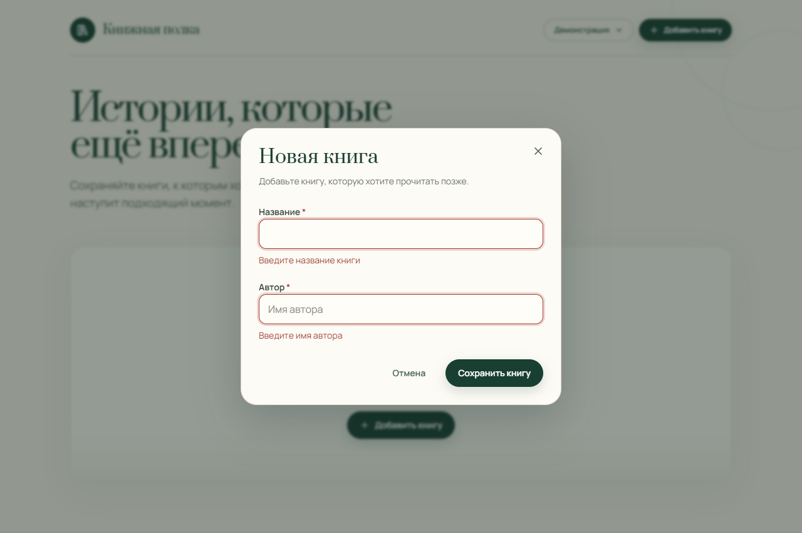
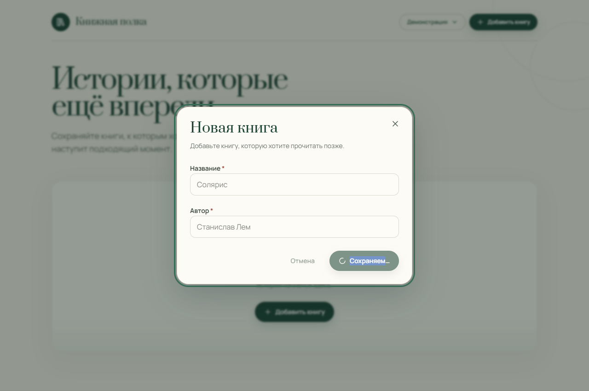
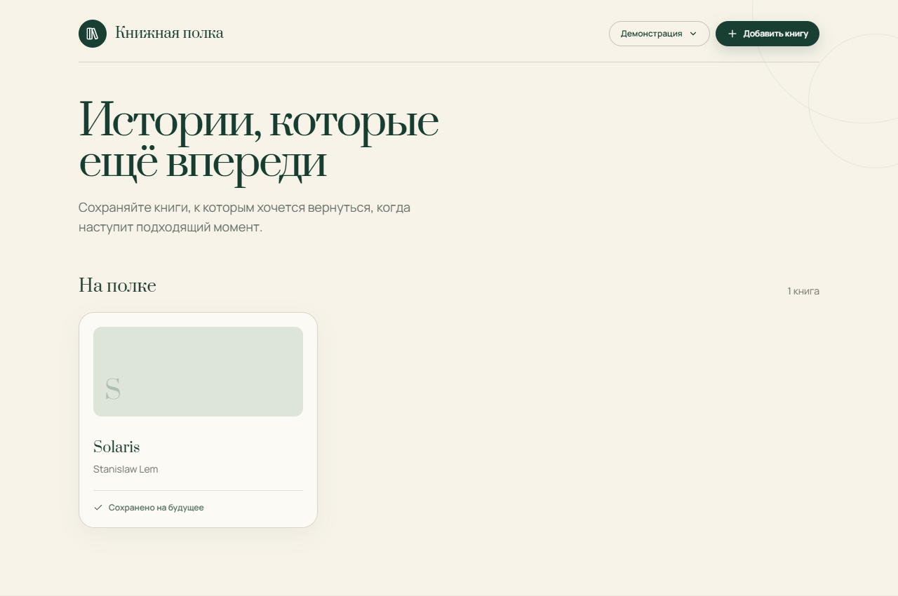
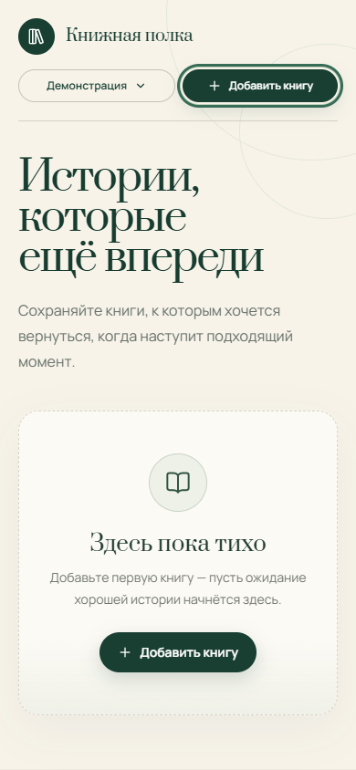

# Книжная полка · практика 8

Читатель добавляет книгу в личный список. После ввода названия и автора и сохранения появляется карточка. При следующем посещении список загружается через API. Работа выполнена на отдельном новом учебном проекте.

## Критерий № 1. Макет или прототип · 3 балла из 12

**Задача пользователя.** Читатель хочет запомнить книгу, чтобы вернуться к ней позже. Он открывает форму «Добавить книгу», вводит название и автора, нажимает «Сохранить книгу» и видит новую карточку на полке.

**Вклад AI.** В первом запросе для Figma Make заданы основной сценарий, обязательные поля и состояния формы. По запросу AI создал полку, диалог ввода и карточку результата. [Открыть прототип](https://www.figma.com/make/3I19ttIHNYVqmSmx83Jeg6/) · [Первый запрос целиком](../FIGMA.md) · [Экспорт прототипа](prototype.zip).

**Проверка и доработка.** В первой версии после добавления «Соляриса» исчезала кнопка «Проверить сценарий ошибки». Это мешало проверить сбой на уже заполненной полке. По результатам проверки в Figma Make был отправлен второй запрос с просьбой перенести сценарий ошибки в меню «Демонстрация». В исправленном макете меню доступно на пустой и на заполненной полке.

**Что показать на защите.** Открыть первый запрос слева в Figma Make. Справа пройти обычный путь от кнопки «Добавить книгу» до новой карточки. Затем открыть «Демонстрация» на заполненной полке и показать, какой недостаток исправлен после проверки.

**Самопроверка.** Прототип доступен по ссылке и в архиве. Основной сценарий воспроизводится, вклад AI и доработка подтверждены историей запросов и двумя снимками. Это подтверждение одного критерия стоимостью 3 балла. Валидация формы отдельно учитывается в критерии № 9.

## Соответствие критериям

| № | Критерий | Где проверить |
|---|---|---|
| 1 | Макет с AI, 3 балла | Две версии в Figma, запрос, экспорт и снимки выше |
| 2 | Компоненты, 0,5 | App.tsx использует Button, Input, Card, Dialog, Label и Alert из src/components/ui. Диалог и меню используют Radix UI |
| 3 | Стиль, 0,5 | Тема Tailwind в src/index.css. Цвета paper и forest, шрифты Prata и Manrope, общий шаг отступов 4 px и стили компонентов |
| 4 | Полный рабочий сценарий, 1 | Тест с настоящим GET и POST проверяет карточку и её сохранность после перезагрузки |
| 5 | Соответствие макету, 1 | Реализация использует экспортированные компоненты. На снимках видны та же шапка, типографика и карточка с инициалом |
| 6 | Доступность, 1 | Подписи связаны с полями, ошибки через aria-describedby. Тест проходит по Tab, открывает диалог по Enter и возвращает фокус по Escape. Проверена ширина 390 px |
| 7 | Защита от дублей, 1 | Синхронная блокировка sending и disabled во время POST. Тест удерживает ответ, делает двойной клик и нажимает Enter, затем проверяет один запрос и одну карточку |
| 8 | Компоненты и взаимодействия, 1 | Клиентские тесты открывают и закрывают диалог, вводят данные, нажимают кнопки и проверяют видимый результат |
| 9 | Валидация, 1 | Проверены пустой автор и название из пробелов, оба сообщения и отсутствие POST |
| 10 | Состояния, 1 | Playwright подменяет GET и POST, включая пустой список, задержку, успех и HTTP 500. При ошибке поля сохраняют значения |
| 11 | Сквозной тест, 1 | Действия с клавиатуры → запрос → карточка → перезагрузка → сохранённая запись |

## Реальное приложение

## Использование AI и результаты

Для макета использованы Figma Make и запрос «Используй готовые компоненты shadcn/ui: Button, Card, Dialog, Input, Label и Alert». Codex адаптировал исходники макета для локального запуска, подключил API и добавил проверки пользовательского поведения. Основное требование к реализации — сохранить экспортированные компоненты и заменить имитацию сохранения на реальный запрос с защитой от повторной отправки. Задача для тестов — воспроизвести ввод, задержку ответа, ошибку, восстановление и проверить число запросов.

При проверке мобильный тест однажды превысил тайм-аут загрузки страницы из-за внешней зависимости от шрифтов. Шрифты включены в сборку. Для проверки качества теста временно отключён вывод ошибки сохранения. Тест упал на ожидании сообщения «Не удалось сохранить книгу». После восстановления кода прошли все шесть тестов. Финальная проверка выполнена в Chrome под Windows.

[Полный вывод запуска](report/tests.txt) · [Вывод проверки с отключённым сообщением](report/mutation.txt) · [Тесты](tests/books.spec.ts) · [Запуск проекта](README.md)

